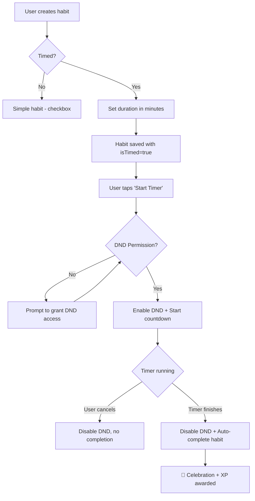

# Implementation Plan — Timer Habit with Auto Focus Mode

## Goal
Add a **Timed Habit** mode alongside the existing Simple (checkbox) habit.  
When a user creates a timed habit (e.g. "Read for 20 min"), they can start a countdown timer inside the app. While the timer runs, the device enters **Do Not Disturb** mode automatically. When the timer finishes, the habit is **auto-completed** and DND is turned off.

## User Review Required

> [!IMPORTANT]
> **DND (Do Not Disturb) requires a special Android permission** (`ACCESS_NOTIFICATION_POLICY`). The user must grant this manually in Settings. We will guide them with a prompt the first time they start a timed habit.

> [!WARNING]
> **iOS limitation**: iOS does not allow apps to toggle Focus/DND programmatically. On iOS, the timer will work but DND activation will be skipped. We can show a prompt asking users to enable Focus manually.

---

## Proposed Changes

### 1. Database Schema (Migration v5 → v6)

#### [MODIFY] [habits_table.dart](file:///c:/Users/ADMIN/Desktop/Habit/lib/core/database/tables/habits_table.dart)
- Add `BoolColumn get isTimed => boolean().withDefault(const Constant(false))()`
- Add `IntColumn get timerDurationMinutes => integer().nullable()()`

#### [MODIFY] [database.dart](file:///c:/Users/ADMIN/Desktop/Habit/lib/core/database/database.dart)
- Bump `schemaVersion` to **6**
- Migration: `addColumn(habits, habits.isTimed)` and `addColumn(habits, habits.timerDurationMinutes)`

---

### 2. Data Model

#### [MODIFY] [habit.dart](file:///c:/Users/ADMIN/Desktop/Habit/lib/features/habits/data/models/habit.dart)
- Add fields to `HabitModel`:
  - `bool isTimed` (default `false`)
  - `int? timerDurationMinutes`
- Update `copyWith()`

---

### 3. DND / Focus Mode Service (Android Native)

#### [NEW] [dnd_service.dart](file:///c:/Users/ADMIN/Desktop/Habit/lib/core/services/dnd_service.dart)
- Platform service using `MethodChannel('com.habit_tracker/dnd')`
- Methods:
  - `Future<bool> isDndPermissionGranted()` — checks `ACCESS_NOTIFICATION_POLICY`
  - `Future<void> requestDndPermission()` — opens Android DND settings
  - `Future<void> enableDnd()` — activates DND via `NotificationManager.INTERRUPTION_FILTER_PRIORITY`
  - `Future<void> disableDnd()` — restores `INTERRUPTION_FILTER_ALL`

#### [MODIFY] [MainActivity.kt](file:///c:/Users/ADMIN/Desktop/Habit/android/app/src/main/kotlin/com/habit_tracker/habit_tracker/MainActivity.kt)
- Register `MethodChannel("com.habit_tracker/dnd")` handler
- Implement Kotlin methods for:
  - `checkDndPermission` → `NotificationManager.isNotificationPolicyAccessGranted`
  - `requestDndPermission` → `Settings.ACTION_NOTIFICATION_POLICY_ACCESS_SETTINGS`
  - `enableDnd` → `setInterruptionFilter(INTERRUPTION_FILTER_PRIORITY)`
  - `disableDnd` → `setInterruptionFilter(INTERRUPTION_FILTER_ALL)`

#### [MODIFY] [AndroidManifest.xml](file:///c:/Users/ADMIN/Desktop/Habit/android/app/src/main/AndroidManifest.xml)
- Add `<uses-permission android:name="android.permission.ACCESS_NOTIFICATION_POLICY"/>`

---

### 4. Habit Timer Service

#### [NEW] [habit_timer_service.dart](file:///c:/Users/ADMIN/Desktop/Habit/lib/features/habits/services/habit_timer_service.dart)
- Lightweight countdown timer (reuses pattern from `FocusTimerService`)
- State: `remainingSeconds`, `totalSeconds`, `status` (idle/running/paused/finished)
- On start → call `DndService.enableDnd()`
- On finish → call `DndService.disableDnd()` + auto-complete habit via callback
- On cancel → call `DndService.disableDnd()`

#### [NEW] [habit_timer_providers.dart](file:///c:/Users/ADMIN/Desktop/Habit/lib/features/habits/providers/habit_timer_providers.dart)
- Riverpod providers for `HabitTimerService` and its state
- `dndServiceProvider` for the DND service

---

### 5. UI Changes

#### [MODIFY] [today_habits_section.dart — AddHabitSheet](file:///c:/Users/ADMIN/Desktop/Habit/lib/features/home/presentation/widgets/today_habits_section.dart)
- Add a **toggle** for "Timed Habit" under Advanced Options
- When toggled ON, show a **custom duration input** — a `TextField` (numeric keyboard, suffix "min") where the user types any number of minutes they want
- Pass `isTimed` and `timerDurationMinutes` to `createHabit`

#### [MODIFY] [habit_detail_screen.dart](file:///c:/Users/ADMIN/Desktop/Habit/lib/features/habits/presentation/habit_detail_screen.dart)
- For timed habits, replace "Complete for Today" button with **"Start Timer"** button
- Show timer duration badge in stats

#### [NEW] [habit_timer_screen.dart](file:///c:/Users/ADMIN/Desktop/Habit/lib/features/habits/presentation/habit_timer_screen.dart)
- Full-screen countdown timer UI (similar style to existing Focus Mode)
- Circular progress ring with remaining time
- Controls: Start, Pause, Cancel
- On completion: celebration animation + auto-mark habit as done
- Shows "Focus Mode Active 🔇" indicator when DND is enabled

#### [MODIFY] [habit_card.dart](file:///c:/Users/ADMIN/Desktop/Habit/lib/features/habits/presentation/widgets/habit_card.dart)
- For timed habits, show a small timer icon (⏱️) badge
- Long-press on timed habit → navigate to timer screen instead of toggle

#### [MODIFY] [router.dart](file:///c:/Users/ADMIN/Desktop/Habit/lib/app/router.dart)
- Add route: `/habits/:habitId/timer` → `HabitTimerScreen`

---

### 6. Notifier Updates

#### [MODIFY] [habit_notifier.dart](file:///c:/Users/ADMIN/Desktop/Habit/lib/core/providers/habit_notifier.dart)
- Update `createHabit()` to accept `isTimed` and `timerDurationMinutes`

---

## Architecture Flow

## Verification Plan

### Automated Tests
- `dart run build_runner build` — regenerate DB code
- `flutter analyze` — zero issues

### Manual Verification
1. Create a simple habit → verify it works as before (no regression)
2. Create a timed habit (e.g., 1 minute for testing)
3. Start the timer → verify DND activates
4. Let it finish → verify habit auto-completes + DND deactivates
5. Start a timer and cancel → verify DND deactivates, habit NOT completed
6. Edit a timed habit in the edit sheet → verify duration persists
